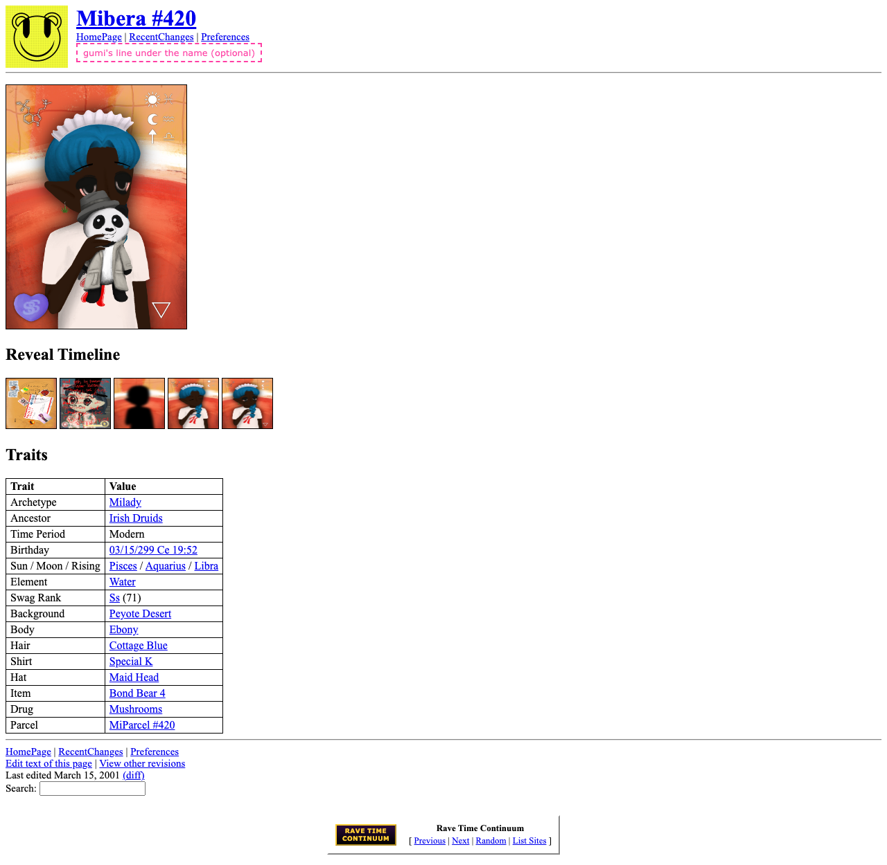
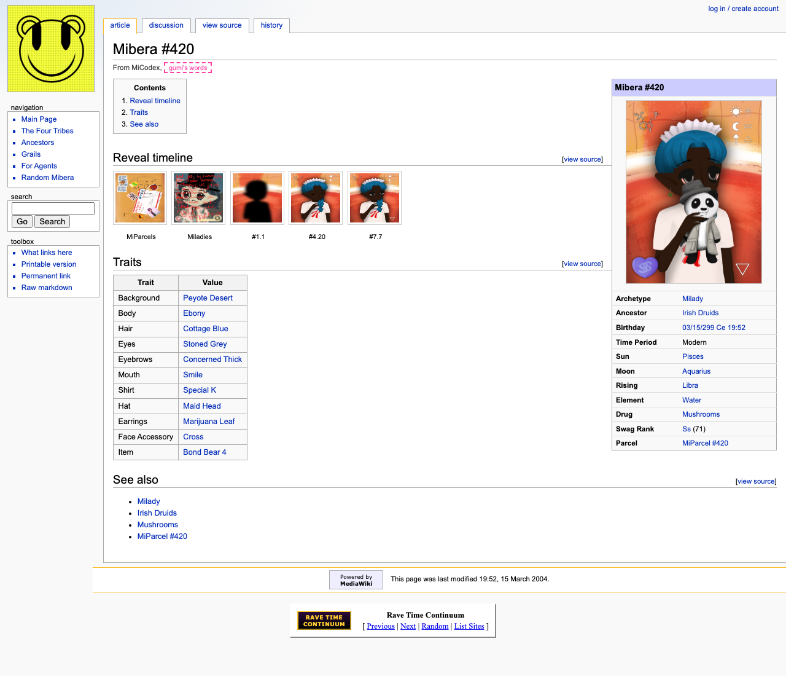

# The codex site, redesigned for the Rave Time Continuum
Reviewed by gumi, 2026-11-03: B, the classic wiki (2004), in the ring as MiCodex; chain words allowed; Claude drafts
the words; every page, MiParcels too; the discussion tab goes to GitHub issues. Being built; nothing deployed yet.
## Your ask
> I kinda want to use different styling which is more aligned with the miberarave timey wimey aesthetic. we do not want to carry over thj's old design
## How the ring looks today
Each part of miberarave.xyz is a real website from its own year of the web, joined by the ring bar at the bottom: The Parcel Office (1994), vrave (1995), the hub (1996, hyperreal.org with the acid flyer), for janitooor (1998), Kairos (2000), Ravepill (2005, vBulletin), micamp (2008), Honey Road (2011) and RAVE CONTINUUM (now). The Vending Machine keeps 2002. Your rule: no two members share a year.

So the codex would become a ring member: a reference site from a year of its own, with the ring bar at the bottom and your smiley as its icon. A wiki fits it best: an encyclopedia anyone can read, where every Mibera, trait, grail and ancestor gets its own page.
## Two looks
Rough mockups of one Mibera's page (#420), built only from its codex file. Pink dashed boxes are where your words would go. To click around, open `docs/redesign/mockups/a-2001.html` or `b-2004.html` in a browser.
### A. 2001: the first wiki
Wikipedia's first year (UseModWiki): the browser's own look, Times and blue links, nothing styled. The crunchiest.

### B. 2004: the classic wiki (my pick)
The MediaWiki look (MonoBook) that every lore wiki of the 2000s copied: tabs with the orange edge, the logo square, side boxes, an infobox and a contents box. People read it at once as "the lore wiki", and the infobox suits a Mibera's traits. The tabs would do real things: **article**, **view source** (the page's markdown file on GitHub, the label MediaWiki showed on locked pages), **history** (its history on GitHub) and **discussion** (Q6).

A third idea, not mocked up: since the ring is a time machine, the codex could be a page from the future instead.
## What goes (THJ's design)
The parchment and Nier palette, the Imperial and Switzer fonts, the seven book covers, the codex-avatar logo, the grimoire panels, the carousel of agent logos and the old share card.
## What stays
- The codex's own words and data, and the art its files link to.
  
- `/skill.md` and `/llms.txt` for agents.
  
- The addresses of today's pages (`/for-agents`, `/grails/<name>` and the rest), so links keep working.
  
## How it would be built
Not a reskin of the current docs app: it's a modern framework that fights a period look. Instead, a small builder reads the codex's own files and writes plain HTML pages in the chosen look, one page per Mibera (10,000), trait (1,337), grail, ancestor, drug, tarot card, era, the lore pages and the agents section. Plain HTML is also true to the period. Every page links its markdown file for agents. It deploys the same way as now, with the same command.

First step, small: the main page and the Mibera page only, built from the real files and shown to you on this Mac. Then the rest, then your look, then your deploy.
## Questions for you
**Q1. The look.** A (2001), B (2004, recommended), the future, or something else? **gumi:** "CLASSIC WIKI YESSS"

**Q2. The ring.** Should the codex join the ring in its year (on the flyer, in List Sites and in Previous and Next)? That's a small change to the hub, deployed by you. Its name there: "MiCodex"? **gumi:** "Yeah"

**Q3. Chain words.** The hub has none, but the codex has an On-Chain section and contract addresses, and the agents pages talk about wallets and chains. Should the codex be like the Vending Machine, where chain words are allowed? **gumi:** "Yeah"

**Q4. Words.** Each page needs a line under its title (the mockup's "From MiCodex, ..."), and the main page needs a few lines. Yours, or should Claude draft them for you to edit? The old software's own labels (article, view source, history, navigation, search, toolbox, What links here, Printable version, Contents, Powered by MediaWiki, This page was last modified) would be used as they are, as Ravepill does with vBulletin's. **gumi:** "claude can draft"

**Q5. MiParcels.** Their 10,000 pages too, or later? **gumi:** "yep . everything."

**Q6. Discussion tab.** Link it to the page's GitHub issues, to a Ravepill thread, or leave it out? **gumi:** "Github issues"
